**BombLab 实验报告**
******
**实验结果：**

从`phase1`到`honor`全部完成。

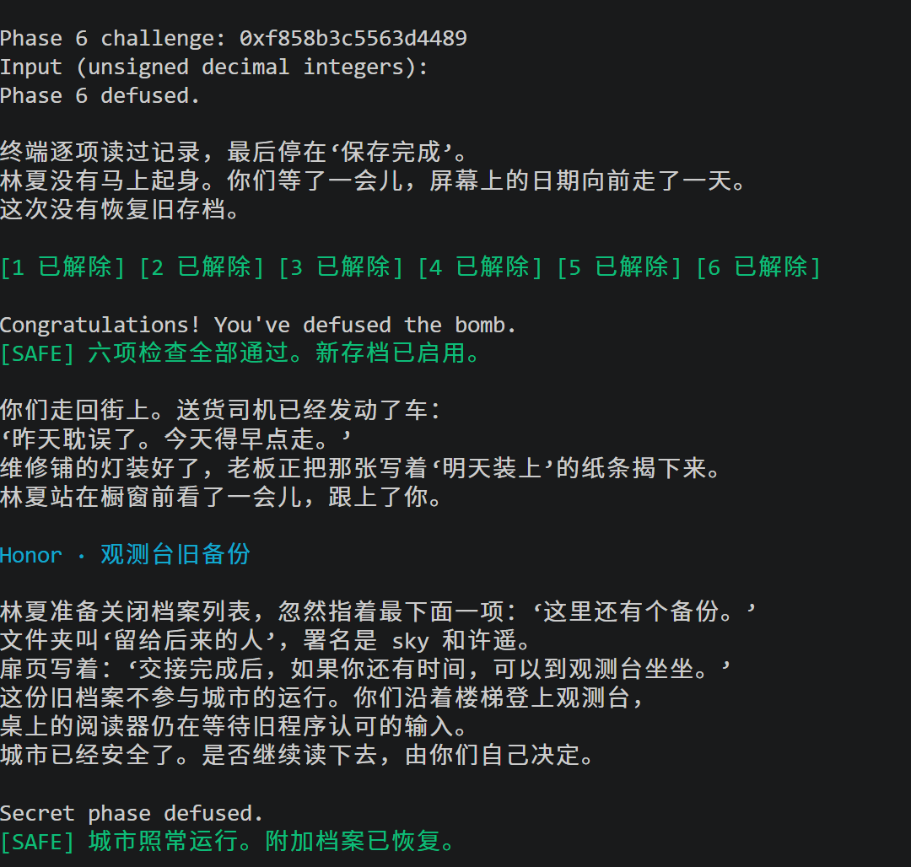

**实验思路：**
- **phase1**

`phase1`是一个比较容易上手和帮助理解整个实验思路的题目。

根据实验指示查看汇编，其中`valid_u32_fields`的作用是看输入是不是32位无符号整数，需要保证我们给的答案是32位无符号整数。`__isoc99_sscanf@plt`则是查看整数个数，根据汇编代码`cmp $0x1,%eax`可知，需要保证输入整数的个数是1个。通过命令`p/x $rsi`可知`rsi`中存储的是`challenge`。后续题目中也包含以上几个部分，按这个思路确定格式，无需反复查看。

下面是`phase1`的特殊部分，主要程序部分就是函数`p1_compute`，由于从`rsi`到`r12`再到`rdi`的传递，进入该函数时，存储`challenge`的寄存器为`rdi`。进入`p1_compute`，就是一个基础的汇编代码，里边还调用了三个函数，但都比较简单。

先计算`p1_step2`的结果，`p1_step2_result = (challenge ^ 0x7d05) + (challenge >> 32) * 8`，存在`eax`里，返回后又存入`ecx`里。再计算`p1_step0`的结果，`p1_step0_result = 0x333b ^ ((challenge >> 16) * 2 + challenge)`，存在`eax`里。把两个结果转存到`esi`和`edi`里后，再进入`p1_step1`，结果就是`p1_step1_result = 0x9392 ^ (p1_step0_result * 3 + p1_step2_result)`，存在`eax`里。

根据汇编`cmp    %eax,-0x14(%rbp)`，这里`-0x14(%rbp)`存的是我们的输入，就是题目希望我们输入的是`p1_step1_result`，所以我们的结果就是`p1_step1_result`。后续题目得出结果的方法也是一样。

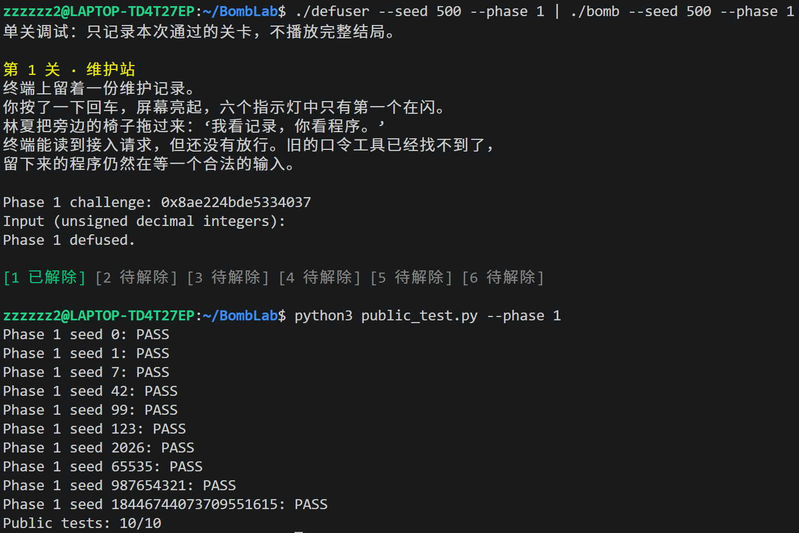

- **phase2**

根据前面所讲的思路和`cmp    $0x6,%eax`直到本题答案为6个32位无符号整数。

通过`jne    0x40217a <phase_02+138>`可知这是一个循环结构。

先来看循环结构之前的部分，可以确定答案的语句是`cmp    %eax,%esi`，又因为`mov    -0x40(%rbp),%esi`可知`values[0]`就是`eax`在这时存储的值，根据前面的汇编得出公式`values[0] = (((challenge >> 41) * 2) & 0x1e) + 0x3`。

再看循环里面的部分，可以通过答案数量和`rdx`的变化知道`for(int i = 1; i < 6; i++)`，同时存在一个变化的`j`，满足起始为19，每次循环加3，得到公式`values[i] = (((challenge >> j) & 0xf) + i) ^ (3 * values[i-1])`。

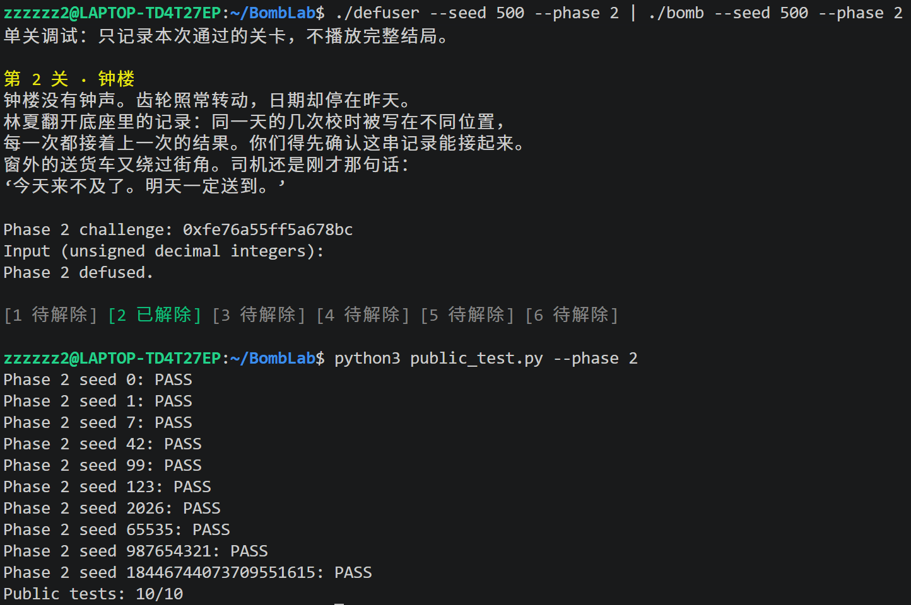

- **phase3**

答案为2个32位无符号数。

`values[0]`容易计算，公式为`values[0] = challenge & 0x7`。同时计算`tmp = (challenge >> 32) ^ (challenge >> 3)`，存在`esi`里。

进入这道题最关键的一个函数`p3_dispatch`，里面是一个非常典型的switch语句的汇编。关键在于跳转`notrack jmp *0x405820(,%rax,8)`，我使用了命令`x/8gx 0x405820`得到下面的结果，知道了0~7对应的运行函数。

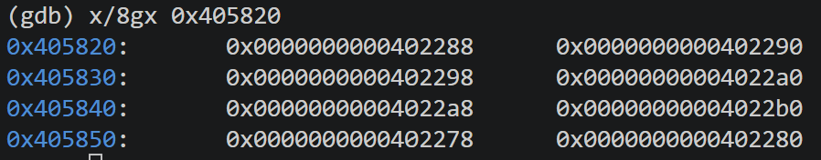

根据每个函数实现对应`case`就好，因为汇编里是`jmp`而非`call`，所以每个`case`里要加`break`。

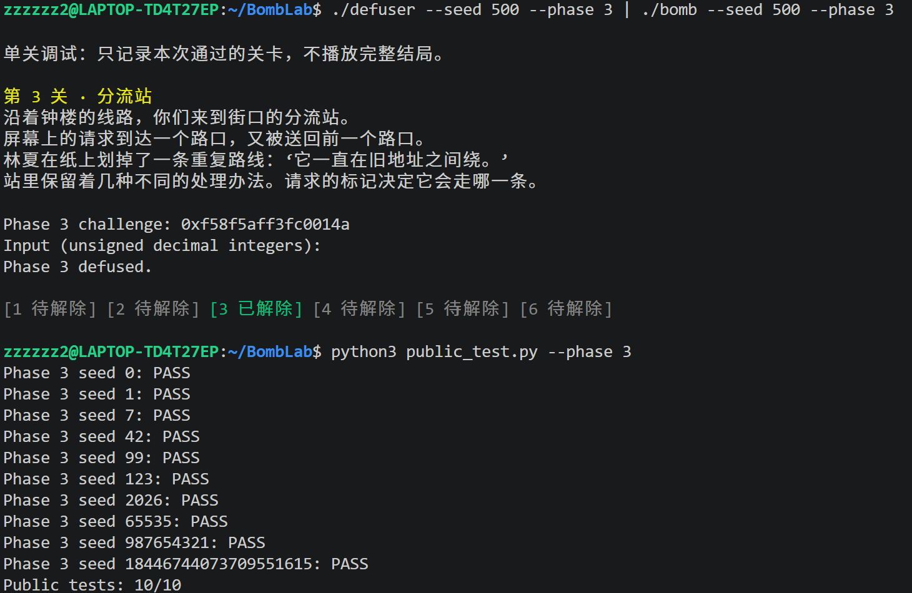

- **phase4**

答案是1个32位无符号数。

这题的关键代码在函数`p4_walk`，因为可以发现函数也调用了`p4_walk`，可知这是一个递归结构，需要一个辅助函数。里面还有许多跳转和返回语句，可知里面还有`if`结构。

因为`p4_walk`函数里的汇编过于复杂，我按照寄存器的方式命名我的相关变量，并逐步完成同样的操作。在完成后发现这是一个类似于二分算法。

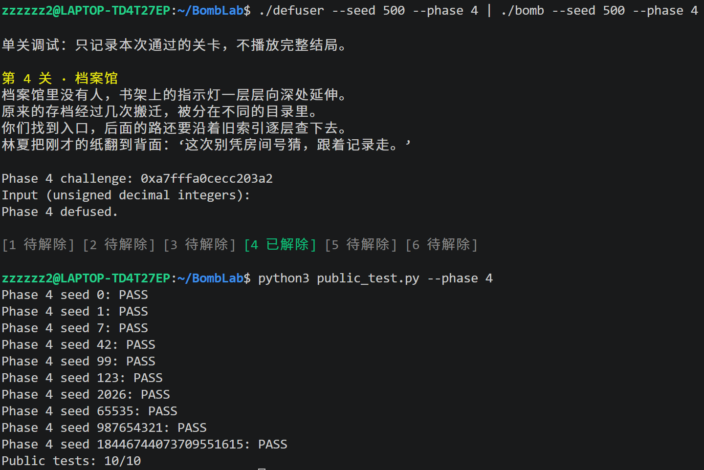

- **phase5**

答案是2个32位无符号数。

代码的关键部分在`p5_traverse`，里面有一个循环，和一个比较特殊的语句`mov    0x405b60(,%rax,8),%rdx`。

先来分析后面这句话，可以通过`(%rdx),%rdx`判断这里`rdx`存下的是一个结构体的地址。使用命令`x/8gx 0x405b60`，就能得到8个头指针。

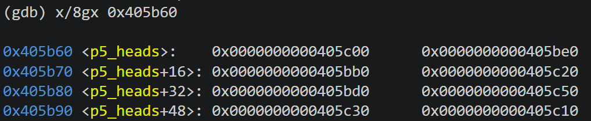

再运行命令`x/4gx 0x405c00`和`x/4dw 0x405c00`得知这是一个链表，链表的每个节点是一个结构体，并且能得出结构体里的两个变量value1和value2的值，以及链表指向的下一个位置next，这些都是直接存在内存里的。这里可以通过next找到这个链表，根据题目可知需要11个节点，再把`value1`和`value2`全部得出，在程序开始时进行初始化。

完成这些之后也对`values[0]`和`values[1]`进行了循环之前的运算，是有关第`j = challenge & 0x7`个头指针结构体里的值，`values[1] = p5_heads[j].value1`，`values[0] = ((challenge >> 32) ^ (challenge >> 6) ^ p5_heads[j].value2 ^ 0xef5e) + values[1]`。

循环就是在链表上跳跃`(challenge >> 3) & 3`次，并对`values[0]`和`values[1]`进行更新。

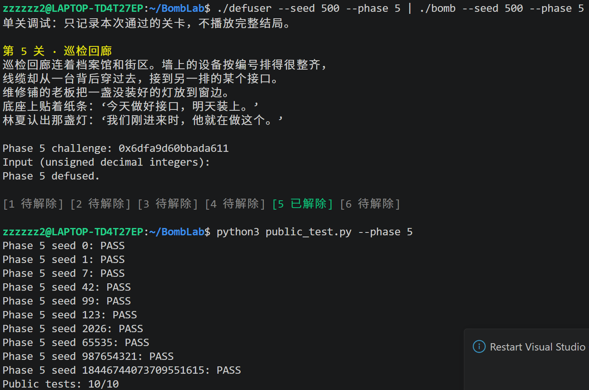

- **phase6**

答案是1个32位无符号数。

代码的关键部分在`p6_dispatch`，进入可以看到语句`call   *0x405e00(,%rax,8)`，通过命令`x/8a 0x405e00`，可以得到8个有重复的函数。

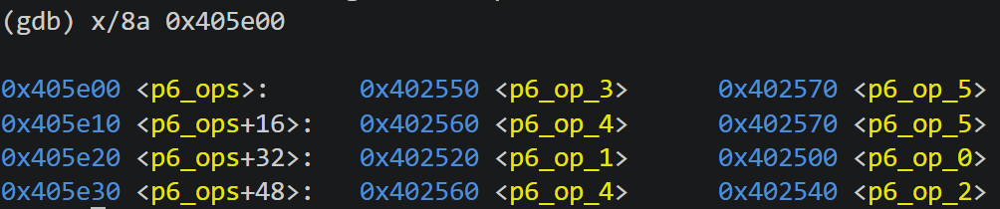

这是一个`switch`语句套一些函数，可以不写成辅助函数的样子，直接在`solve`函数里实现，也可以在函数定义时写成`void p6_op_0(uint32_t *tmp1,uint32_t *tmp2)`保证对`tmp1`和`tmp2`的操作有效。

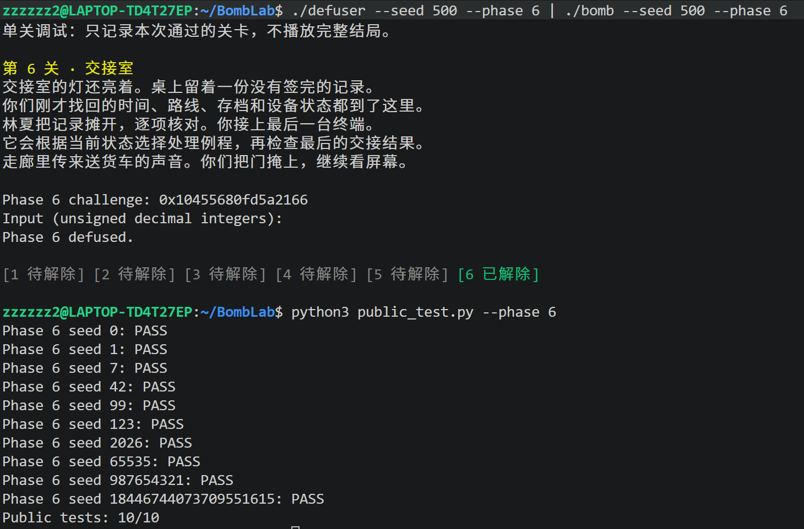

- **honor**

这道题与之前不同的就是它的答案是一个字符串，`strlen@plt`函数过后`rax`存的是我们输入的字符串长度，又有`sub    $0x24,%rax`和`cmp    $0x7f,%rax`可知目标字符串长度为163。`cmpl   $0x4e45504f,-0xb0(%rbp)`则说明字符串的第32到35位为`OPEN`。`secret_copy`将前面所说的部分去掉剩下的是3个32位无符号数和若干空格。并且注意本题给了`challenge`和`context`，分别存在`rsi`和`rdx`里。

下面进入`secret_phase`，这是本题最主要的部分。三个数都没有复杂的结构和计算，第一个数和第三个数的公式分别是`first_number = context & 0x3`，`third_number = ((uint32_t)((challenge >> 32) ^ challenge) >> 3) + ((context >> 32) ^ context) + 0x93db + first_number`。第二个数计算稍微复杂，需要`tmp`辅助，`tmp = ((challenge >> 32) ^ challenge) ^ ((context >> 32) ^ context)`，`tmp = (tmp ^ 0x28c4) + ((tmp >> 3) ^ 0x93db)`，`second_number = tmp ^ ((first_number * 0x28c4) ^ (context >> 16))`。

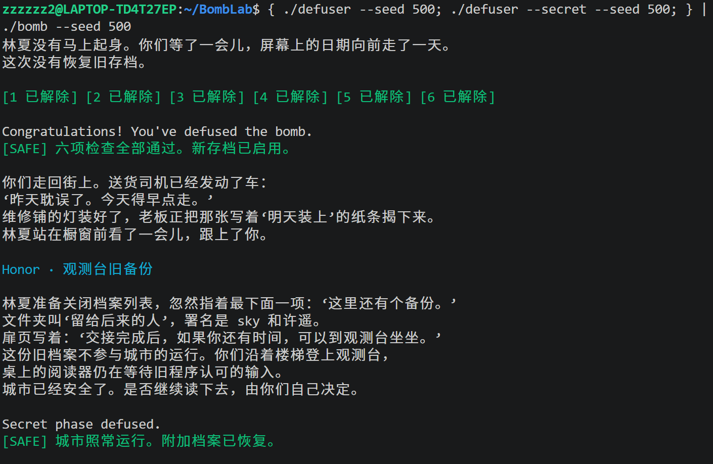

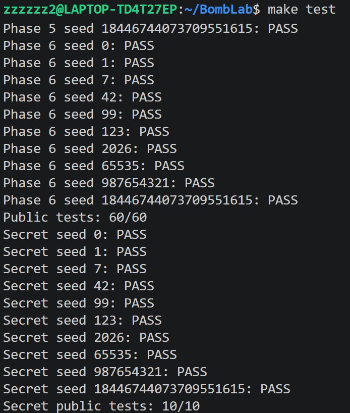